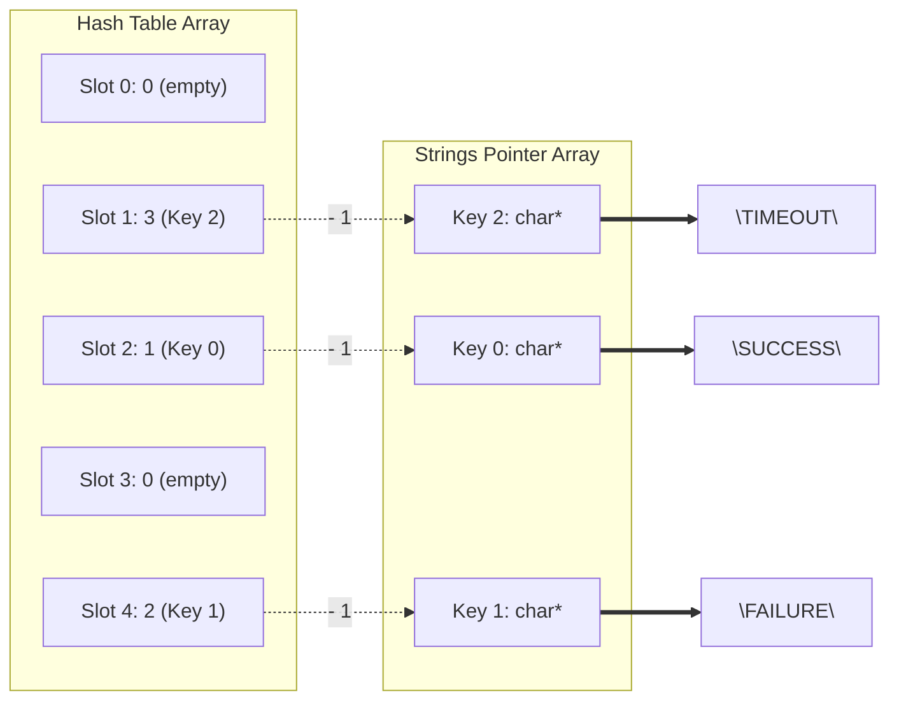

# Day 6: High-Cardinality String Dictionaries

In analytical databases, string columns present a fundamental tension between representation cost and comparison speed. Storing raw variable-length strings in a column wastes memory bandwidth and makes comparisons computationally expensive. In `simpledb`, string columns are dictionary-encoded: each unique string is stored once in a compact table, and every row holds a small integer key referencing that table.

---

## 1. The Problem with Raw Strings in Columnar Filters

Consider a table with 10,000,000 event rows. A `status` column containing values like `"SUCCESS"`, `"FAILURE"`, and `"TIMEOUT"` repeated across every row represents several megabytes of redundant character data in a naive row-oriented layout.

When a filter predicate evaluates `WHERE status = 'SUCCESS'`, a row-oriented engine compares `strlen("SUCCESS")` characters for every row. A columnar engine with dictionary encoding replaces that character comparison with a single integer lookup.

The dictionary is constructed once at column ingestion time:

```
Dictionary Table:
  Key 0 → "SUCCESS"
  Key 1 → "FAILURE"
  Key 2 → "TIMEOUT"

Encoded Column (10,000,000 rows):
  [0, 1, 0, 0, 2, 1, 0, 0, 0, 1, ...]  ← int32_t array, one key per row
```

Filtering `WHERE status = 'SUCCESS'` becomes a branchless scan over an `int32_t` array comparing against the integer `0`. String comparison is removed from the execution loop.

---

## 2. Reusing `buffer_i32_t` for Encoded Keys

A dictionary key is a small non-negative integer. Values 0 through 65,534 fit inside an `int32_t`. Introducing a separate `buffer_u16_t` type would require redundant implementations for array operations.

`simpledb` utilizes `buffer_i32_t` directly for the encoded column. The dictionary limit is capped at 65,535 entries, and `string_dict_insert` returns `-1` as a sentinel when that limit is exceeded. Operators designed for `buffer_i32_t` and `slice_i32_t` function correctly on dictionary key columns without modification.

---

## 3. Dictionary Data Structure Layout

The string dictionary consists of two cooperating components: a string storage arena and a lookup index for deduplication.

```c
// [include/simpledb/string_dict.h]

#pragma once

#include <stddef.h>
#include <stdint.h>
#include <stdbool.h>
#include "simpledb/allocator.h"

#define STRING_DICT_MAX_ENTRIES 65535
#define STRING_DICT_NOT_FOUND   (-1)
#define STRING_DICT_HASH_SLOTS  131072

typedef struct {
    char**    strings;      // Heap-allocated string pointers
    uint32_t* hash_table;   // Open-addressing hash index: slot -> entry index + 1
    int32_t   count;        // Number of unique strings inserted
} string_dict_t;

string_dict_t* string_dict_create(void);
void           string_dict_free(string_dict_t* dict);

int32_t string_dict_insert(string_dict_t* dict, const char* str);
int32_t string_dict_lookup(const string_dict_t* dict, const char* str);

bool string_dict_encode_column(string_dict_t* dict,
                               const char**   raw_strings,
                               size_t         count,
                               buffer_i32_t*  out_keys);
```

The dictionary API provides four core operations:
- **Lifecycle**: `string_dict_create` and `string_dict_free` manage memory for internal arrays.
- **Write**: `string_dict_insert` adds a new string and returns its integer key.
- **Read**: `string_dict_lookup` finds the key for an existing string.
- **Bulk Encode**: `string_dict_encode_column` processes raw string arrays into a dense `buffer_i32_t` column.

Memory allocations utilize `calloc` to ensure all array slots initialize to `0`. Consistent with previous design decisions, allocation failure is treated as a fatal error.

---

## 4. Open-Addressing Hash Table

During column ingestion, the dictionary must determine whether a string exists and assign it a key in O(1) average time. Open addressing is used to maintain a flat index structure, improving cache locality compared to separate chaining.



When `hash_table[slot]` contains a non-zero value, subtracting `1` yields the index in the `strings` array containing the character data.

```c
// [src/string_dict.c]

static uint32_t string_dict_hash(const char* str) {
    uint32_t h = 2166136261u;
    while (*str) {
        h ^= (uint8_t)(*str++);
        h *= 16777619u;
    }
    return h;
}

int32_t string_dict_insert(string_dict_t* dict, const char* str) {
    if (!dict || !str) return STRING_DICT_NOT_FOUND;
    if (dict->count >= STRING_DICT_MAX_ENTRIES) return STRING_DICT_NOT_FOUND;

    uint32_t h    = string_dict_hash(str);
    uint32_t slot = h & (STRING_DICT_HASH_SLOTS - 1);

    while (dict->hash_table[slot] != 0) {
        int32_t idx = (int32_t)(dict->hash_table[slot] - 1);
        if (strcmp(dict->strings[idx], str) == 0) {
            return idx;
        }
        slot = (slot + 1) & (STRING_DICT_HASH_SLOTS - 1);
    }

    int32_t new_key           = dict->count;
    dict->strings[new_key]    = strdup(str);
    dict->hash_table[slot]    = (uint32_t)(new_key + 1);
    dict->count++;
    return new_key;
}
```

The probe sequence is linear, maintaining predictable cache access patterns. The modulo operation for slot mapping is replaced by a bitwise AND operation (`h & (STRING_DICT_HASH_SLOTS - 1)`), executing in a single CPU cycle, leveraging the power-of-two table capacity.

---

## 5. Encoding and Filtering Key Columns

Column ingestion utilizes `string_dict_insert` to append keys into a `buffer_i32_t`.

```c
// [src/string_dict.c]

bool string_dict_encode_column(string_dict_t* dict,
                               const char**   raw_strings,
                               size_t         count,
                               buffer_i32_t*  out_keys) {
    if (!dict || !raw_strings || !out_keys) return false;

    buffer_i32_ensure_capacity(out_keys, out_keys->size + count);

    for (size_t i = 0; i < count; i++) {
        int32_t key = string_dict_insert(dict, raw_strings[i]);
        if (key == STRING_DICT_NOT_FOUND) return false;
        buffer_i32_push(out_keys, key);
    }
    return true;
}
```

Filter predicates translate directly into integer comparisons. Resolving `WHERE status = 'SUCCESS'` requires one dictionary lookup before the scan.

```c
// [src/filter.c]

bool filter_eq_i32(slice_i32_t src, int32_t target, selection_vector_t* out_sel) {
    if (!src.data || !out_sel) return false;

    buffer_i32_ensure_capacity(out_sel, out_sel->size + src.len);

    for (size_t i = 0; i < src.len; i++) {
        bool match              = src.data[i] == target;
        out_sel->data[out_sel->size] = (int32_t)i;
        out_sel->size          += match;
    }
    return true;
}
```

---

## 6. Query Execution and Late Materialization

A query combining numeric and string predicates executes entirely over integer arrays:

```
Query: WHERE status = 'SUCCESS' AND salary > 50000

Execution:
  1. Translate predicate to key:
       target_key = string_dict_lookup(dict, "SUCCESS")  → 0

  2. Filter dictionary key column (int32_t scan):
       filter_eq_i32(status_keys_slice, 0, &sel1)
       → sel1 = [0, 2, 3, 7, ...]

  3. Filter salary column restricted to sel1:
       filter_gt_i32_sel(salary_col, 50000, &sel1, &sel2)
       → sel2 = [2, 7, ...]

  4. Gather output columns:
       gather_i32(salary_col, &sel2, &out_salary)
       gather_i32_decode(status_keys, dict, &sel2, &out_status_strings)
```

The string data is bypassed during filter execution and materialized only during the final step. `gather_i32_decode` resolves the original string values for rows present in `sel2`.

```c
// [src/filter.c]

bool gather_i32_decode(slice_i32_t keys_src, const string_dict_t* dict, const selection_vector_t* sel, const char*** out_strings) {
    if (!keys_src.data || !dict || !sel || !out_strings) return false;

    *out_strings = malloc(sel->size * sizeof(char*));
    if (!*out_strings) {
        fprintf(stderr, "[FATAL ERROR] failed to allocate output string array\n");
        exit(EXIT_FAILURE);
    }

    for (size_t i = 0; i < sel->size; i++) {
        int32_t row_idx = sel->data[i];
        int32_t dict_key = keys_src.data[row_idx];
        (*out_strings)[i] = dict->strings[dict_key];
    }
    return true;
}
```

This indirection process, converting row indices to dictionary keys and subsequently to string pointers, prevents unnecessary CPU cache invalidation.

---

## 7. Storage Efficiency

| Representation | Memory per Row | 10M Row Column Cost | Filter Comparison |
| :- | :- | :- | :- |
| Raw `char*` pointer array | 8 bytes pointer + string bytes | ~80 MB + string heap | `strcmp` |
| Fixed 32-byte char array | 32 bytes | 320 MB | SIMD 32-byte compare |
| Dictionary `int32_t` key | 4 bytes | 40 MB | Integer `==` |

Dictionary encoding reduces memory bandwidth consumption, offering a compact representation for high-cardinality string columns.

---

> **Source Code**: The full C11 codebase for this project is available on GitHub at [dmanchon/simpledb](https://github.com/dmanchon/simpledb).
