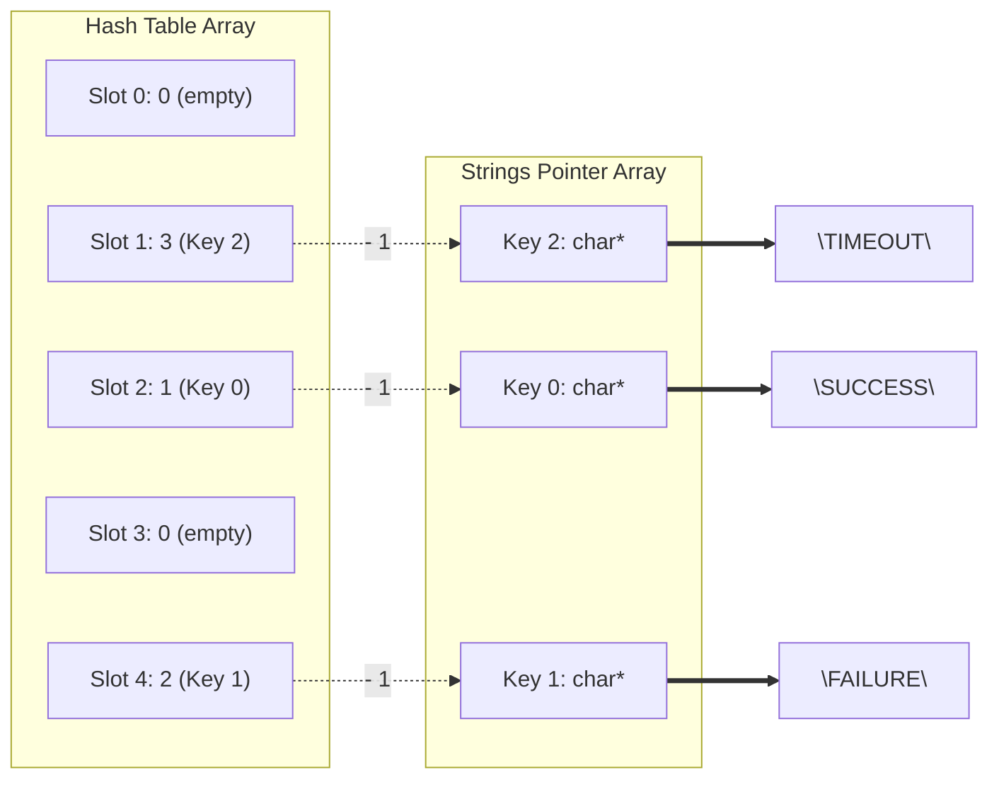

In analytical databases, string columns present a fundamental tension between representation cost and comparison speed. Storing raw variable-length strings in a column wastes memory bandwidth and makes comparison expensive. In `simpledb`, string columns are dictionary-encoded: each unique string is stored once in a compact table, and every row holds only a small integer key that references that table.

---

## 1. The Problem with Raw Strings in Columnar Filters

Consider a table with 10,000,000 event rows. A `status` column containing values like `"SUCCESS"`, `"FAILURE"`, and `"TIMEOUT"` repeated across every row represents several megabytes of redundant character data in a naive row-oriented layout.

When a filter predicate evaluates `WHERE status = 'SUCCESS'`, a row-oriented engine compares `strlen("SUCCESS")` characters for every row. A columnar engine with dictionary encoding replaces that comparison with a single integer lookup.

The dictionary is built once at column ingestion time:

```
Dictionary Table:
  Key 0 → "SUCCESS"
  Key 1 → "FAILURE"
  Key 2 → "TIMEOUT"

Encoded Column (10,000,000 rows):
  [0, 1, 0, 0, 2, 1, 0, 0, 0, 1, ...]  ← int32_t array, one key per row
```

Filtering `WHERE status = 'SUCCESS'` becomes a branchless scan over an `int32_t` array comparing against the integer `0`. No string comparison occurs inside the hot loop.

---

## 2. Reusing `buffer_i32_t` as the Encoded Key Column

A dictionary key is a small non-negative integer. Values 0 through 65,534 fit inside an `int32_t` with room to spare. Introducing a separate `buffer_u16_t` type would require its own `push`, `grow`, and `ensure_capacity` functions — a parallel infrastructure that duplicates everything `buffer_i32_t` already provides.

`simpledb` uses `buffer_i32_t` directly for the encoded column. The dictionary limit is capped at 65,535 entries, and `string_dict_insert` returns `-1` as a sentinel when that limit is exceeded. Every operator that already works with `buffer_i32_t` and `slice_i32_t` — `filter_gt_i32`, `gather_i32`, `buffer_i32_ensure_capacity` — works on dictionary key columns without modification.

DuckDB and ClickHouse internally use narrower key widths (`uint8_t`, `uint16_t`, `uint32_t`) and switch between them at runtime based on observed cardinality. That adaptive width strategy requires type dispatch and separate code paths. `simpledb` trades 2 bytes per row for zero new infrastructure.

---

## 3. Data Structure Layout

The string dictionary requires two cooperating components: a compact string storage arena and a lookup index for deduplication. The encoded column is an ordinary `buffer_i32_t` from Day 1.

```c
// [include/simpledb/string_dict.h]

#pragma once

#include <stddef.h>
#include <stdint.h>
#include <stdbool.h>
#include "simpledb/allocator.h"

#define STRING_DICT_MAX_ENTRIES 65535
#define STRING_DICT_NOT_FOUND   (-1)
#define STRING_DICT_HASH_SLOTS  131072  // Power of 2, >= 2 * MAX_ENTRIES

typedef struct {
    char**    strings;      // Heap-allocated string pointers, one per unique entry
    uint32_t* hash_table;   // Open-addressing hash index: slot -> entry index + 1 (0 = empty)
    int32_t   count;        // Number of unique strings inserted so far
} string_dict_t;

string_dict_t* string_dict_create(void);
void           string_dict_free(string_dict_t* dict);

int32_t string_dict_insert(string_dict_t* dict, const char* str);
int32_t string_dict_lookup(const string_dict_t* dict, const char* str);

bool string_dict_encode_column(string_dict_t* dict,
                               const char**   raw_strings,
                               size_t         count,
                               buffer_i32_t*  out_keys);
```

To keep the module contract clean, `string_dict.h` handles only the dictionary's state and ingestion. Query execution (like the `filter_eq_i32` kernel) lives separately in `filter.h`.

The dictionary API provides four core operations:
- **Lifecycle**: `string_dict_create` and `string_dict_free` manage the memory for the internal arrays.
- **Write**: `string_dict_insert` adds a string if it's new and returns its integer key.
- **Read**: `string_dict_lookup` finds the key for an existing string (used when translating a `WHERE` clause).
- **Bulk Encode**: `string_dict_encode_column` processes raw string arrays into a dense `buffer_i32_t` column.

**Out-of-Memory Handling and `calloc`**
Consistent with the memory strategy established on Day 1 for `aligned_malloc`, `string_dict_create` treats allocation failure as a fatal error. If `malloc` or `calloc` fails, the engine prints a fatal error and exits immediately, avoiding the complexity of cascading `NULL` checks throughout the caller hierarchy. 

We allocate the `hash_table` with `calloc` to ensure all slots initialize to `0` (the empty marker). For consistency and defensive programming, the `strings` array is also allocated with `calloc`. While `string_dict_free` is optimized to only iterate up to `dict->count`, zeroing the entire array guarantees that unused slots are predictably `NULL` should any future logic inspect them.

---

## 4. Open-Addressing Hash Table for Deduplication

When a new string arrives during column ingestion, the dictionary must answer two questions in O(1) average time: does this string already exist in the table, and if not, what key should it receive?

A separate chaining hash table (linked list buckets) causes pointer-chasing misses that defeat CPU prefetching. Open addressing keeps the index flat: all entries live in a single contiguous `uint32_t` array, so a cache line fetch from `hash_table[slot]` brings adjacent probe slots into L1 cache simultaneously.



This visualization clearly separates the index (`hash_table`) from the data storage (`strings`). When `hash_table[slot]` contains a non-zero value, subtracting `1` yields the exact index in the `strings` array where the raw character data lives.

```c
// [src/string_dict.c]

static uint32_t string_dict_hash(const char* str) {
    // FNV-1a 32-bit hash
    uint32_t h = 2166136261u;
    while (*str) {
        h ^= (uint8_t)(*str++);
        h *= 16777619u;
    }
    return h;
}

int32_t string_dict_insert(string_dict_t* dict, const char* str) {
    if (!dict || !str) return STRING_DICT_NOT_FOUND;
    if (dict->count >= STRING_DICT_MAX_ENTRIES) return STRING_DICT_NOT_FOUND;

    uint32_t h    = string_dict_hash(str);
    uint32_t slot = h & (STRING_DICT_HASH_SLOTS - 1);

    // Linear probe until empty slot or matching entry
    while (dict->hash_table[slot] != 0) {
        int32_t idx = (int32_t)(dict->hash_table[slot] - 1);
        if (strcmp(dict->strings[idx], str) == 0) {
            return idx;  // Existing entry — return its key
        }
        slot = (slot + 1) & (STRING_DICT_HASH_SLOTS - 1);
    }

    // New entry: store string and record slot
    int32_t new_key           = dict->count;
    dict->strings[new_key]    = strdup(str);
    dict->hash_table[slot]    = (uint32_t)(new_key + 1);  // +1 so 0 means empty
    dict->count++;
    return new_key;
}
```

The `+ 1` sentinel convention reserves slot value `0` as the empty marker without requiring a separate boolean `occupied` array. The probe sequence is linear (`slot + 1`) rather than quadratic or double-hashed, which keeps cache locality predictable during construction. At a load factor of 50% (65,535 entries in 131,072 slots), average probe length remains below 1.5.

**Fast Modulo with Bitwise AND**
Mapping a 32-bit hash down to a slot index requires a modulo operation (`h % STRING_DICT_HASH_SLOTS`). However, the modulo operator (`%`) compiles to an integer division instruction, which is famously slow (often 10–20 CPU cycles). 

Because `STRING_DICT_HASH_SLOTS` is strictly a power of 2 (131,072), subtracting 1 produces a bitmask of consecutive 1s (`131071` is `0x1FFFF` in hex, or exactly 17 bits set to 1). Bitwise ANDing the hash with this mask (`h & (STRING_DICT_HASH_SLOTS - 1)`) is mathematically identical to the modulo operation, but executes in a single CPU cycle. This is why power-of-two capacities are universally preferred in high-performance hash tables.

**Heap Memory Ownership (`strdup`)**
When cleaning up the dictionary, `string_dict_free` must iterate through the `strings` array to `free` each pointer individually before releasing the array itself. The `string_dict_insert` function uses `strdup(str)` to allocate a distinct copy of the inserted string on the heap. Because these allocations exist independently of the pointer array, calling `free(dict->strings)` alone would only release the pointers, leaking the underlying string data. The loop `for (i = 0; i < dict->count; i++) free(dict->strings[i])` ensures that every owned heap allocation is properly released.

---

## 5. Encoding a String Column into a Key Buffer

Column ingestion calls `string_dict_insert` for each raw string row and appends the returned `int32_t` key into an ordinary `buffer_i32_t`. That buffer is the encoded representation of the column stored in memory and serialized to disk.

```c
// [src/string_dict.c]

bool string_dict_encode_column(string_dict_t* dict,
                               const char**   raw_strings,
                               size_t         count,
                               buffer_i32_t*  out_keys) {
    if (!dict || !raw_strings || !out_keys) return false;

    buffer_i32_ensure_capacity(out_keys, out_keys->size + count);

    for (size_t i = 0; i < count; i++) {
        int32_t key = string_dict_insert(dict, raw_strings[i]);
        if (key == STRING_DICT_NOT_FOUND) return false;
        buffer_i32_push(out_keys, key);
    }
    return true;
}
```

`buffer_i32_ensure_capacity` pre-allocates the full worst-case capacity before the encoding loop — the same function used by `filter_gt_i32` in Day 5, applied here to eliminate resizing inside the hot path. `buffer_i32_push` appends each key and is already inlined in the header.

---

## 6. Filtering Dictionary-Encoded Columns Without String Comparison

Once a column is encoded, filter predicates translate directly into integer comparisons. Resolving `WHERE status = 'SUCCESS'` requires only one dictionary lookup before the scan. 

The lookup function uses the exact same hash and probe sequence as `insert`, but it never modifies the table — returning `STRING_DICT_NOT_FOUND` if it hits an empty slot before finding a match:

```c
// [src/string_dict.c]

int32_t string_dict_lookup(const string_dict_t* dict, const char* str) {
    if (!dict || !str) return STRING_DICT_NOT_FOUND;

    uint32_t h = string_dict_hash(str);
    uint32_t slot = h & (STRING_DICT_HASH_SLOTS - 1);

    while (dict->hash_table[slot] != 0) {
        int32_t idx = (int32_t)(dict->hash_table[slot] - 1);
        if (strcmp(dict->strings[idx], str) == 0) {
            return idx;  // Found it
        }
        slot = (slot + 1) & (STRING_DICT_HASH_SLOTS - 1);
    }
    return STRING_DICT_NOT_FOUND; // Hit an empty slot
}
```

With the target key in hand, the actual filter scan over the millions of rows is entirely branchless integer math:

```c
// [src/filter.c]

// 1. Translate string predicate to integer key once
int32_t target_key = string_dict_lookup(dict, "SUCCESS");

// 2. filter_eq_i32: selection vector filter, equality variant

bool filter_eq_i32(slice_i32_t src, int32_t target, selection_vector_t* out_sel) {
    if (!src.data || !out_sel) return false;

    buffer_i32_ensure_capacity(out_sel, out_sel->size + src.len);

    for (size_t i = 0; i < src.len; i++) {
        bool match              = src.data[i] == target;
        out_sel->data[out_sel->size] = (int32_t)i;
        out_sel->size          += match;
    }
    return true;
}
```

`filter_eq_i32` is structurally identical to `filter_gt_i32` from Day 5: unconditional index write, branchless size increment. The only difference is the comparison operator. Because the encoded column is a `buffer_i32_t` and the key is an `int32_t`, no type coercion or new slice type is needed — the same `slice_i32_t` and `selection_vector_t` infrastructure drives both numeric range filters and dictionary equality filters.

---

## 7. Query Execution with Dictionary-Encoded Strings

With the dictionary in place, a query combining numeric and string predicates executes entirely over integer arrays:

```
Query: WHERE status = 'SUCCESS' AND salary > 50000

Execution:
  1. Translate predicate to key:
       target_key = string_dict_lookup(dict, "SUCCESS")  → 0

  2. Filter dictionary key column (int32_t scan, 4 bytes/row):
       filter_eq_i32(status_keys_slice, 0, &sel1)
       → sel1 = [0, 2, 3, 7, ...]   (row indices where status = SUCCESS)

  3. Filter salary column restricted to sel1 (int32_t scan):
       filter_gt_i32_sel(salary_col, 50000, &sel1, &sel2)
       → sel2 = [2, 7, ...]          (rows matching both predicates)

  4. Gather output columns:
       gather_i32(salary_col, &sel2, &out_salary)
       gather_i32_decode(status_keys, dict, &sel2, &out_status_strings)
```

The full string data in `dict->strings` is never touched during filter execution. Let's explicitly define the two new functions introduced in steps 3 and 4 that make this possible.

**Filtering with an Existing Selection Vector**
In step 3, `filter_gt_i32_sel` filters the numeric `salary` column, but it restricts its evaluation to rows that already passed the `status` filter (stored in `sel1`). It reads `in_sel` to find the row index, evaluates the predicate, and conditionally writes the matching row index to `out_sel`:

```c
// [src/filter.c]

bool filter_gt_i32_sel(slice_i32_t src, int32_t target, const selection_vector_t* in_sel, selection_vector_t* out_sel) {
    if (!src.data || !in_sel || !out_sel) return false;

    buffer_i32_ensure_capacity(out_sel, out_sel->size + in_sel->size);

    for (size_t i = 0; i < in_sel->size; i++) {
        int32_t row_idx = in_sel->data[i];
        bool match = src.data[row_idx] > target;
        out_sel->data[out_sel->size] = row_idx;
        out_sel->size += match;
    }
    return true;
}
```
This chaining technique prevents redundant evaluations and keeps intermediate results compact.

**Late Materialization of Strings**
In step 4, `gather_i32_decode` materializes the original string values *only* for the rows that survived all predicates in `sel2`. 

This requires a "double jump" (double indirection) to get from a matched row to its actual text:
1. **Row Index**: First, we read `sel->data[i]` to get the row number that passed our filters (e.g., Row 142).
2. **Dictionary Key**: Next, we look up that row in the encoded column (`keys_src.data[142]`) to find its integer key (e.g., Key `0`).
3. **String Pointer**: Finally, we look up that key in the dictionary (`dict->strings[0]`) to get the actual `char*` pointer (e.g., `"SUCCESS"`).

```c
// [src/filter.c]

bool gather_i32_decode(slice_i32_t keys_src, const string_dict_t* dict, const selection_vector_t* sel, const char*** out_strings) {
    if (!keys_src.data || !dict || !sel || !out_strings) return false;

    *out_strings = malloc(sel->size * sizeof(char*));
    if (!*out_strings) {
        fprintf(stderr, "[FATAL ERROR] failed to allocate output string array\n");
        exit(EXIT_FAILURE);
    }

    for (size_t i = 0; i < sel->size; i++) {
        int32_t row_idx = sel->data[i];
        int32_t dict_key = keys_src.data[row_idx];
        (*out_strings)[i] = dict->strings[dict_key];
    }
    return true;
}
```
This double jump is the essence of late materialization. The bulky string data is completely ignored during the query execution. It is never fetched into the CPU cache until this very last step, and even then, only for the exact rows that will be returned to the user.

**Common C Pointer Pitfalls**
Materializing an array of string pointers introduces several classic C traps when dealing with `const char***` parameters:

1. **Operator Precedence**: When assigning to the output array inside the loop, you must write `(*out_strings)[i] = ...`. If you write `*out_strings[i] = ...`, the compiler evaluates the array index `[]` before the dereference `*`. It will step forward in memory by `i` elements *before* dereferencing, reading random memory and causing a segmentation fault.
2. **Double Pointers for Allocation**: A function cannot modify a caller's pointer if it is passed by value. By passing `const char*** out_strings` (a pointer to a pointer), `gather_i32_decode` can allocate the array internally (`*out_strings = malloc(...)`) and have that allocation surface back to the caller.
3. **Caller Invocation**: Because of the rule above, the caller must declare a single pointer and pass its address. Passing an uninitialized triple pointer will crash:
```c
// WRONG: Passes uninitialized garbage pointer
const char*** out_strings;
gather_i32_decode(..., out_strings);

// CORRECT: Passes address of a local double pointer
const char** out_strings = NULL;
gather_i32_decode(..., &out_strings);
```

---


## 8. Memory Layout and Storage Efficiency

| Representation | Memory per Row | 10M Row Column Cost | Filter Comparison |
| :- | :- | :- | :- |
| Raw `char*` pointer array | 8 bytes pointer + string bytes | ~80 MB + string heap | `strcmp` (branch-heavy, cache-unfriendly) |
| Fixed 32-byte char array | 32 bytes | 320 MB | SIMD 32-byte compare |
| Dictionary `int32_t` key | 4 bytes | 40 MB | Integer `==` (branchless) |

Dictionary encoding reduces a 320 MB fixed-width string column to 40 MB of integer keys — an 8x reduction in memory bandwidth consumed during every filter scan, with zero new buffer infrastructure.

---

## 9. How String Dictionaries Connect to Days 7–16

The `string_dict_t` built on Day 6 becomes a shared dependency across several subsequent layers.

**Day 7 — Null Bitmaps and Dynamic Schema Registry**: The schema registry maps column names to their types. String columns register a `string_dict_t` pointer alongside their `buffer_i32_t` key array, allowing the schema to describe both data and encoding in a single descriptor.

**Day 9 — On-Disk Column Layout**: Serializing a dictionary-encoded column requires writing two binary files: the `buffer_i32_t` key array as a `.bin` column file, and the dictionary strings as a `.dict` companion file. The mark file (`.mrk`) offsets reference positions in the key array, not in raw string data.

**Day 11 — Free-Text Inverted Block Indexing**: For full-text columns that exceed dictionary cardinality (log message bodies, user-generated content), the inverted index replaces dictionary encoding. The Day 6 dictionary lookup infrastructure informs the design of that tokenization and posting-list lookup pipeline.

**Day 15 — APL / K Vectorized Physical Execution Pipeline**: The physical pipeline assembles operators in sequence. `filter_eq_i32` and `filter_gt_i32` are interchangeable filter nodes that both emit `selection_vector_t` outputs, allowing the planner to chain them without knowing whether the underlying column holds numeric data or dictionary keys.

---

> **Source Code**: The full C11 codebase for this project is available on GitHub at [dmanchon/simpledb](https://github.com/dmanchon/simpledb).
